# Asignación 4: Hardening de red con CIS Benchmarks

[](https://youtu.be/35Fl-7O98fk)

> 🎥 **Video demostrativo:** https://youtu.be/35Fl-7O98fk

**Estudiante:** Angel Alcantara · **Matrícula:** 2024-2356
**Institución:** ITLA · Seguridad de Redes

---

## Contenido

1. [Propósito del laboratorio](#1-propósito-del-laboratorio)
2. [Topología y direccionamiento](#2-topología-y-direccionamiento)
3. [Herramientas de análisis CIS](#3-herramientas-de-análisis-cis)
4. [Recomendaciones CIS aplicadas: router y switch](#4-recomendaciones-cis-aplicadas-router-y-switch)
5. [Recomendaciones CIS aplicadas: firewall](#5-recomendaciones-cis-aplicadas-firewall)
6. [Recomendaciones no aplicadas](#6-recomendaciones-no-aplicadas)
7. [Script de hardening](#7-script-de-hardening-cis_hardeningpy)
8. [Pruebas de las recomendaciones](#8-pruebas-de-las-recomendaciones)
9. [Hallazgos sobre las herramientas](#9-hallazgos-sobre-las-herramientas)
10. [Problemas encontrados y soluciones](#10-problemas-encontrados-y-soluciones)
11. [Estructura del repositorio](#11-estructura-del-repositorio)

---

## 1. Propósito del laboratorio

El objetivo es endurecer (hardening) los tres tipos de equipos de una red —**router, switch y firewall**— siguiendo los **CIS Benchmarks**, y comprobar con pruebas reales que la red queda más segura.

La red se montó primero con una configuración **insegura a propósito** (Telnet abierto, contraseñas en texto plano, SNMP con `public`, llave RSA de 1024 bits, gestión del firewall expuesta en la WAN, política con servicio `ALL`, etc.). Después:

1. Se analizó cada equipo con una herramienta basada en el CIS Benchmark correspondiente.
2. Se eligieron las recomendaciones que aplican a esta red y se justificaron las que no.
3. Se desarrolló un **script propio en Python** que audita los equipos contra esas recomendaciones y puede generar un informe sin cambiar nada, o aplicar las reglas y generar un informe posterior.
4. Se probó desde fuera de la red, desde la red de usuarios y desde la red de gestión que los controles funcionan.

**Objetivo de seguridad de la red:** nadie desde internet ni desde la red de usuarios puede administrar los equipos; solo la VLAN de gestión (Kali) puede hacerlo. Los usuarios solo pueden usar los servicios autorizados hacia internet, y todos los eventos quedan registrados en un servidor syslog central.

---

## 2. Topología y direccionamiento

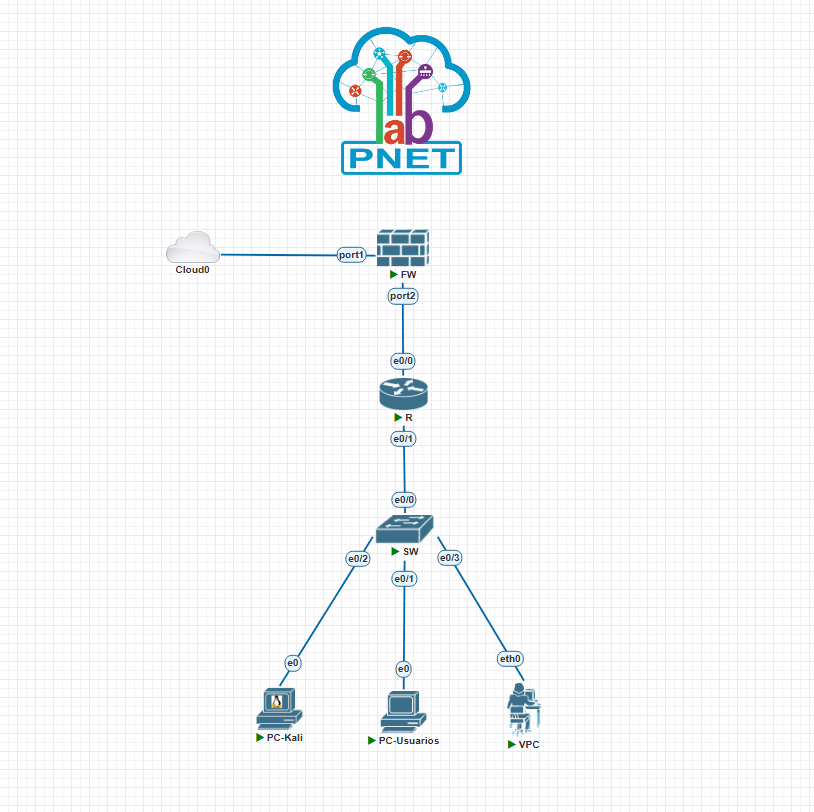

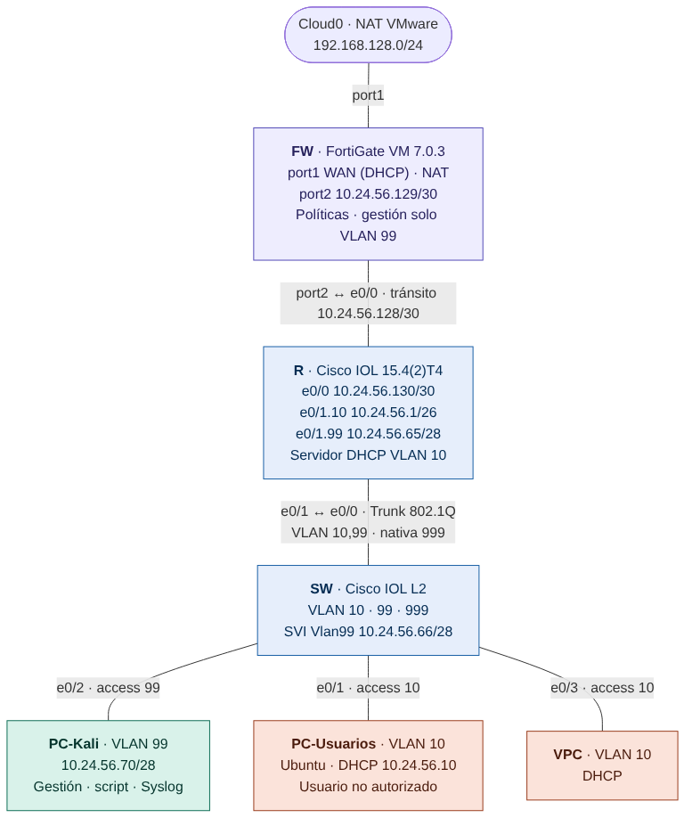

### Direccionamiento (basado en la matrícula 2024-2356 → 10.24.56.0/24)

| Segmento | Red | Gateway | Uso |
|---|---|---|---|
| VLAN 10 USUARIOS | 10.24.56.0/26 | 10.24.56.1 | DHCP desde R (.10 – .62) |
| VLAN 99 GESTION | 10.24.56.64/28 | 10.24.56.65 | SW .66 · Kali .70 (estática) |
| Tránsito FW ↔ R | 10.24.56.128/30 | — | FW .129 · R .130 |
| VLAN 999 BLACKHOLE | — | — | VLAN nativa del trunk |
| WAN | 192.168.128.0/24 (DHCP) | 192.168.128.2 | Salida a internet con NAT en el FW |

| Equipo | Imagen | Rol |
|---|---|---|
| **FW** | FortiGate VM 7.0.3 | Firewall perimetral: NAT, políticas de salida, sin gestión desde la WAN |
| **R** | Cisco IOL 15.4(2)T4 | Router-on-a-stick, servidor DHCP de la VLAN 10 |
| **SW** | Cisco IOL L2 | Switch de acceso con VLAN 10, 99 y 999 |
| **PC-Kali** | Kali Linux | Estación de gestión: corre las herramientas y el script, recibe syslog y consulta SNMP |
| **PC-Usuarios** | Ubuntu 20.04 | Usuario no autorizado, desde donde se hacen las pruebas de ataque |
| **VPC** | VPCS | Cliente DHCP de la VLAN de usuarios |

### Control de acceso resultante

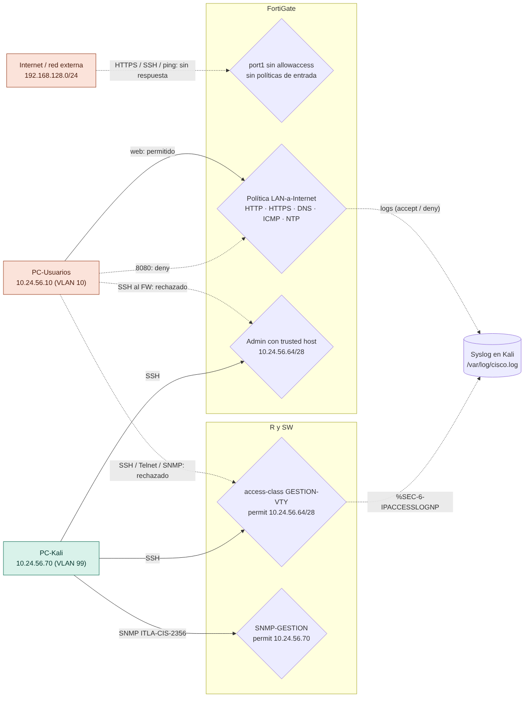

---

## 3. Herramientas de análisis CIS

| Equipo | Herramienta | Benchmark |
|---|---|---|
| R y SW | [ONYX: CAAAT](https://github.com/UncleSocks/Onyx) | CIS Cisco IOS 15 Benchmark v4.1.1 |
| FW | [Fortigate_CIS_check](https://github.com/Coldfirex/Fortigate_CIS_check) (copia en [`scripts/terceros`](scripts/terceros)) | CIS FortiGate 7.0.x Benchmark v1.3.0 |

Se usaron estas herramientas porque **CIS-CAT Pro** requiere membresía de CIS SecureSuite y **CIS-CAT Lite** no incluye benchmarks de Cisco ni de Fortinet.

```bash
# ONYX (R y SW)
cd Onyx/src/onyx_unclesocks
python3 onyx.py -i -t ios -v 15 -o R-antes.html

# Fortigate_CIS_check (FW)
python3 scripts/fw_exportar_config.py FW-antes.conf
bash scripts/terceros/fortigate_cis_checker.sh FW-antes.conf
```

### Resultados antes y después

| Equipo | Herramienta | Antes | Después |
|---|---|---|---|
| R | ONYX | 14 Passed / 49 Failed | **43 Passed / 20 Failed** |
| SW | ONYX | 13 Passed / 50 Failed | **43 Passed / 20 Failed** |
| FW | Fortigate_CIS_check | 15 PASS / 19 FAIL | 16 PASS / 18 FAIL |
| R | Script propio | 2 cumple / 38 no cumple / 1 excepción | **40 cumple / 0 no cumple / 1 excepción** |
| SW | Script propio | 2 cumple / 38 no cumple / 1 N/A | **40 cumple / 0 no cumple / 1 N/A** |
| FW | Script propio | 3 cumple / 14 no cumple | **16 cumple / 1 no cumple** |

Los "Failed" que quedan en las herramientas son, en su mayoría, controles que se decidió no aplicar ([sección 6](#6-recomendaciones-no-aplicadas)) o falsos negativos de las propias herramientas ([sección 9](#9-hallazgos-sobre-las-herramientas)).

Reportes completos: [`reportes/onyx`](reportes/onyx) · [`reportes/fortigate-cis-check`](reportes/fortigate-cis-check) · [`reportes/script`](reportes/script)

---

## 4. Recomendaciones CIS aplicadas: router y switch

**Benchmark:** CIS Cisco IOS 15 Benchmark v4.1.1

### Plano de gestión

| CIS | Control | Configuración aplicada | Por qué se aplicó |
|---|---|---|---|
| 1.1.1 – 1.1.3 | AAA | `aaa new-model`, `aaa authentication login default local`, `aaa authentication login CIS-LOCAL local`, `aaa authentication enable default enable` | Centraliza la autenticación y permite definir el método de login por línea |
| 1.1.4 | Login en consola | `line con 0` → `login authentication CIS-LOCAL` | Antes la consola daba acceso sin credenciales |
| 1.1.6 | Login en VTY | `line vty 0 4` → `login authentication CIS-LOCAL` | Toda sesión remota pasa por AAA |
| 1.2.1 | Privilegio 1 | `username admin privilege 1 secret ...` | El usuario tenía privilegio 15; ahora necesita `enable` para administrar |
| 1.2.2 | Solo SSH | `transport input ssh` | Telnet viaja en texto plano y era atacable por fuerza bruta |
| 1.2.3 | Sin exec en AUX | `line aux 0` → `no exec` | Cierra un acceso de gestión que no se usa |
| 1.2.4 y 1.2.5 | ACL de gestión | ACL `GESTION-VTY` (solo 10.24.56.64/28) + `access-class GESTION-VTY in` | Solo la VLAN de gestión puede administrar |
| 1.2.7 y 1.2.9 | Exec-timeout | `exec-timeout 5 0` en consola y VTY | Cierra sesiones abandonadas |
| 1.3.1 – 1.3.3 | Banners | `banner exec/login/motd` | Aviso legal de acceso restringido |
| 1.4.1 | Enable secret | `enable secret ...` + `no enable password` | La contraseña de enable estaba en texto plano |
| 1.4.2 | Cifrado de contraseñas | `service password-encryption` | Evita contraseñas legibles en el `show run` |
| 1.4.3 | Username secret | `username admin secret ...` | El usuario tenía `password 0 admin123` |
| 1.5.3 | Quitar `public` | `no snmp-server community public` | Es la primera comunidad que prueba cualquier atacante |
| 1.5.5 y 1.5.6 | SNMP con ACL | ACL `SNMP-GESTION` (solo Kali) + `snmp-server community ITLA-CIS-2356 RO SNMP-GESTION` | Solo la estación de gestión puede consultar SNMP |
| 1.5.7 y 1.5.8 | Traps SNMP | `snmp-server host 10.24.56.70 ...` + `snmp-server enable traps snmp ...` | Los eventos se notifican a Kali |

### Plano de control

| CIS | Control | Configuración aplicada | Por qué se aplicó |
|---|---|---|---|
| 2.1.1.1.3 | RSA ≥ 2048 | `crypto key generate rsa general-keys modulus 2048` | La llave era de 1024 bits |
| 2.1.1.1.4 | Timeout SSH | `ip ssh time-out 60` | Antes 120 s |
| 2.1.1.1.5 | Reintentos SSH | `ip ssh authentication-retries 3` | Limita intentos por conexión |
| 2.1.1.2 | SSH v2 | `ip ssh version 2` | El equipo aceptaba SSH 1.99 (compatibilidad con SSHv1) |
| 2.1.2 | CDP | `no cdp run` | CDP revela modelo, IOS e IP |
| 2.1.3 | BOOTP | `no ip bootp server` | Servicio innecesario |
| 2.1.4 (solo SW) | DHCP | `no service dhcp` | El switch no es servidor DHCP |
| 2.1.6 y 2.1.7 | TCP keepalives | `service tcp-keepalives-in/out` | Limpia sesiones TCP muertas |
| 2.1.8 | PAD | `no service pad` | Servicio X.25 obsoleto |
| 2.2.2 | Buffer de logs | `logging buffered 64000` | Conserva los logs en memoria |
| 2.2.3 | Logs en consola | `logging console critical` | Evita saturar la consola |
| 2.2.4 | Syslog | `logging host 10.24.56.70` | Logs centralizados en Kali |
| 2.2.5 | Nivel de trap | `logging trap informational` | Ya cumplía (valor por defecto) |
| 2.2.7 | Origen de logs | `logging source-interface Ethernet0/1.99` (R) / `Vlan99` (SW) | Los logs salen siempre desde la IP de gestión |

### Plano de datos

| CIS | Control | Configuración aplicada | Por qué se aplicó |
|---|---|---|---|
| 3.1.1 | Source routing | `no ip source-route` | Impide que el emisor decida la ruta del paquete |
| 3.1.2 | Proxy ARP | `no ip proxy-arp` en todas las interfaces configurables | Evita que el equipo responda ARP por otros hosts |
| 3.1.4 (solo R) | uRPF | `ip verify unicast source reachable-via rx` en e0/1.10 y e0/1.99 | Descarta paquetes con IP de origen falsificada desde las VLAN internas |

---

## 5. Recomendaciones CIS aplicadas: firewall

**Benchmark:** CIS FortiGate 7.0.x Benchmark v1.3.0

| CIS | Control | Configuración aplicada | Por qué se aplicó |
|---|---|---|---|
| 1.3 | Sin gestión en la WAN | `port1` → `unset allowaccess` | La WAN aceptaba HTTP, HTTPS, SSH y ping desde afuera |
| 2.1.1 / 2.1.2 | Banners | `set pre-login-banner enable` / `set post-login-banner enable` | Aviso legal antes y después del login |
| 2.1.5 | Hostname | `set hostname FW` | El nombre por defecto revelaba el modelo |
| 2.1.7 | USB | `config system auto-install` → `auto-install-config/image disable` | Evita cargar firmware o configuración desde una USB |
| 2.1.8 | Llaves TLS estáticas | `set ssl-static-key-ciphers disable` | Fuerza cifrados con secreto perfecto hacia adelante (PFS) |
| 2.1.10 | TLS de la GUI | `admin-https-ssl-versions tlsv1-2 tlsv1-3` | Ya cumplía (valor por defecto en 7.0.3); se verifica en cada auditoría |
| 2.2.1 | Política de contraseñas | `config system password-policy` (mín. 8, mayúscula, minúscula, número y símbolo) | Al activarla, FortiOS **obligó a cambiar** la contraseña del admin porque no cumplía |
| 2.2.2 | Bloqueo de cuenta | `admin-lockout-threshold 3`, `admin-lockout-duration 900` | Frena ataques de fuerza bruta |
| 2.4.2 | Trusted hosts | `set trusthost1 10.24.56.64 255.255.255.240` en el admin | Solo la VLAN de gestión puede administrar el FW |
| 2.4.4 | Timeout | `set admintimeout 5` | Ya cumplía (valor por defecto) |
| 2.4.5 | Solo canales cifrados | `port2` → `set allowaccess https ssh` | Se quitaron HTTP y ping |
| 3.2 | Sin servicio `ALL` | Política 1 → `set service HTTP HTTPS DNS ALL_ICMP NTP` | La LAN podía salir por cualquier puerto |
| 3.4 | Log en las políticas | `set logtraffic all` en todas las políticas + `fwpolicy-implicit-log enable` | Registra el tráfico permitido y el denegado |
| 7.1.1 | Eventos | `config log eventfilter` → `set event enable` | Ya cumplía |
| 7.3.1 | Syslog central | `config log syslogd setting` → servidor 10.24.56.70, `source-ip 10.24.56.129` | Logs del FW centralizados en Kali |

`fwpolicy-implicit-log` (registro del tráfico denegado) se activó a mano después del script, durante las pruebas.

---

## 6. Recomendaciones no aplicadas

| Equipo | CIS | Control | Motivo |
|---|---|---|---|
| R/SW | 1.1.7 – 1.1.11 | AAA accounting (nivel 2) | Requiere un servidor TACACS+/RADIUS que no existe en la topología |
| R/SW | 1.5.1 | Deshabilitar SNMP | Se usa para monitoreo; en vez de quitarlo se endureció (sin `public`, con ACL y traps) |
| R | 2.1.4 | `no service dhcp` | **Excepción:** R es el servidor DHCP de la VLAN 10 |
| R/SW | 2.3.x | NTP autenticado | No hay servidor NTP en el laboratorio |
| R/SW | 2.4.x | Interfaz loopback (nivel 2) | Como origen de logs se usa la interfaz de gestión |
| SW | 3.1.4 | uRPF | No aplica en un switch de capa 2 |
| R | 3.2.x | Filtrado de borde (nivel 2) | El borde ahora es el FortiGate |
| FW | 2.1.9 | `strong-crypto` | El FortiGate rechazó el comando; se atribuye a la licencia de evaluación del FortiGate VM (cifrado reducido). Los demás controles de cifrado (2.1.8 y 2.1.10) sí se aplicaron |
| FW | 2.3.x | Solo SNMPv3 | El FW no usa SNMP; la telemetría se envía por syslog |
| FW | 2.4.7 | Cambiar puertos de gestión | Seguridad por oscuridad; el acceso ya está limitado por trusted hosts |
| FW | 2.4.9 – 2.4.11 | Alta disponibilidad | Requiere un segundo FortiGate |
| FW | 4.x | Antivirus, IPS, filtro DNS, control de aplicaciones | Requieren licencias FortiGuard |
| FW | 5.x | Security Fabric / cuarentena | Requieren FortiAnalyzer/FortiClient EMS |

---

## 7. Script de hardening: `cis_hardening.py`

📄 [`scripts/cis_hardening.py`](scripts/cis_hardening.py)

Script en Python que usa **Netmiko** para conectarse por SSH a **R, SW y FW**, revisar las recomendaciones CIS elegidas (41 en los equipos Cisco y 17 en el FortiGate) y, opcionalmente, aplicarlas.

| Modo | Qué hace |
|---|---|
| `--auditar` | Revisa los equipos, guarda la configuración y genera un **informe sin aplicar ninguna regla** |
| `--aplicar` | Audita, aplica **solo las reglas que fallan**, guarda la configuración, vuelve a auditar y genera un **informe posterior** |

```bash
pip install -r scripts/requirements.txt
python3 scripts/cis_hardening.py --auditar                 # R, SW y FW
python3 scripts/cis_hardening.py --aplicar --equipo FW     # un solo equipo
```

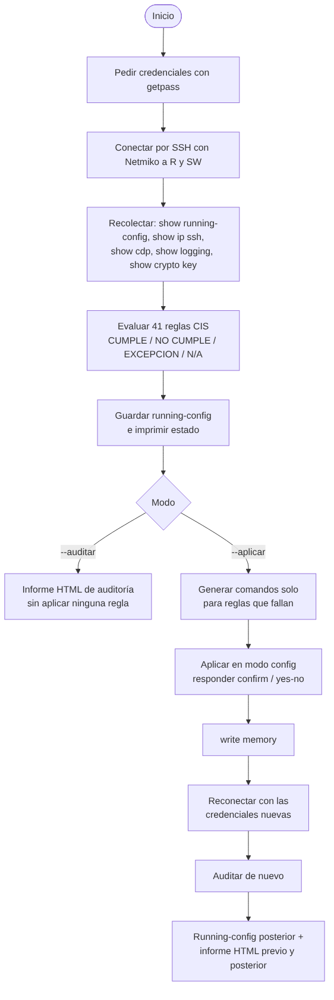

**Características:**

- Cada regla tiene su función de verificación y su corrección, y se distinguen los estados **CUMPLE / NO CUMPLE / EXCEPCIÓN / N/A**.
- En Cisco interpreta el `show running-config` y salidas como `show ip ssh` y `show crypto key mypubkey rsa`; así detecta, por ejemplo, el tamaño real de la llave RSA.
- En FortiGate lee valores reales con `get system global`, `get system password-policy`, `show system interface`, etc., en lugar de buscar palabras en el archivo.
- Responde las confirmaciones de IOS (`[confirm]`, `yes/no`) y reporta los comandos que den error.
- Las contraseñas se piden con `getpass` (nunca están en el código), y las nuevas se piden dos veces para evitar errores de tipeo.
- Guarda la configuración de cada equipo antes y después en [`running-configs`](running-configs).

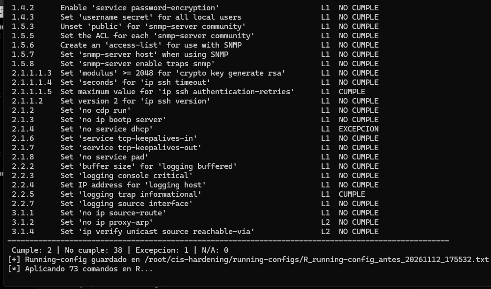

Informes generados: [`reportes/script`](reportes/script)

### Otros scripts

| Script | Uso |
|---|---|
| [`fw_exportar_config.py`](scripts/fw_exportar_config.py) | Exporta `show full-configuration` del FW con Netmiko (acepta el post-login banner) |
| [`kali_syslog_setup.sh`](scripts/kali_syslog_setup.sh) | Configura Kali como servidor syslog UDP 514 |
| [`pruebas_demostracion.sh`](scripts/pruebas_demostracion.sh) | Comandos de las pruebas mostradas en el video |
| [`terceros/fortigate_cis_checker.sh`](scripts/terceros/fortigate_cis_checker.sh) | Herramienta CIS de FortiGate (licencia MIT) |

---

## 8. Pruebas de las recomendaciones

### Desde fuera de la red (Windows, 192.168.128.1)

| Prueba | Resultado | CIS |
|---|---|---|
| `Test-NetConnection 192.168.128.160 -Port 443 / 22 / 80` | `TcpTestSucceeded : False` y `PingSucceeded : False` | FW 1.3 |

### Desde PC-Usuarios (VLAN 10, no autorizado)

| Prueba | Antes | Después | CIS |
|---|---|---|---|
| `nmap -p 22,23` a R y SW | 22 y 23 **open** | 22 y 23 **closed** | 1.2.2, 1.2.5 |
| `telnet 10.24.56.65` | Acepta conexión | `Connection refused` | 1.2.2 |
| `ssh admin@10.24.56.65` | Acepta conexión | `Connection refused` | 1.2.5 |
| `snmpwalk -v2c -c public` | Comunidad `public` activa | `Timeout: No Response` | 1.5.3, 1.5.5 |
| `hydra -l admin -P clave.txt telnet://` | Telnet abierto y `admin123` en el diccionario | `can not connect`, 0 contraseñas válidas | 1.2.2, 1.4.3 |
| `curl -4 -sI http://example.com` | — | `HTTP/1.1 200 OK` (permitido) | FW 3.2 |
| `nc -4 -zv -w 5 portquiz.net 8080` | — | `timed out` + log `action="deny"` | FW 3.2, 3.4 |
| `ssh admin@10.24.56.129` (FW) | — | Sin respuesta (trusted hosts) | FW 2.4.2 |

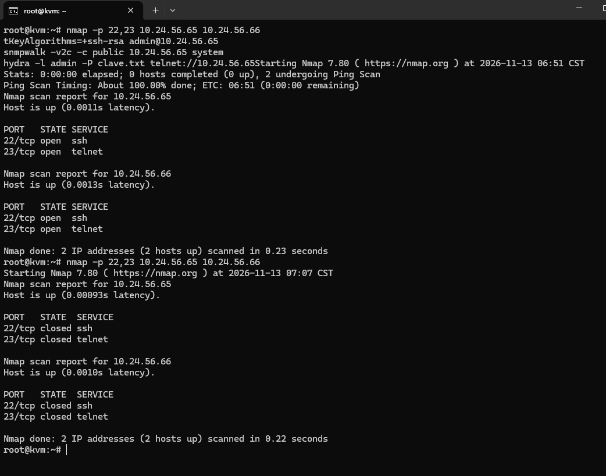
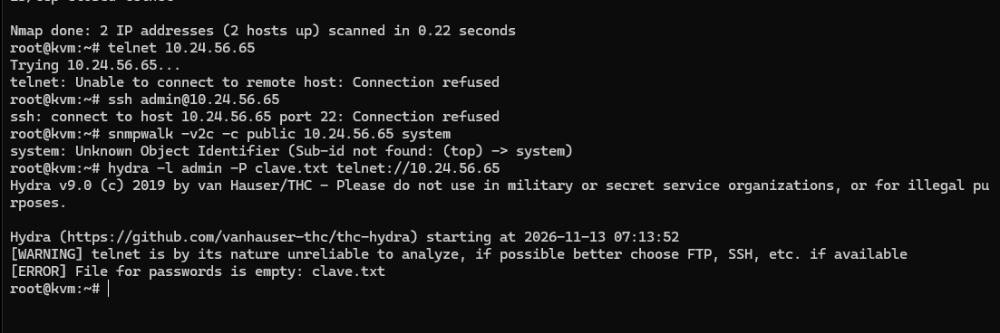
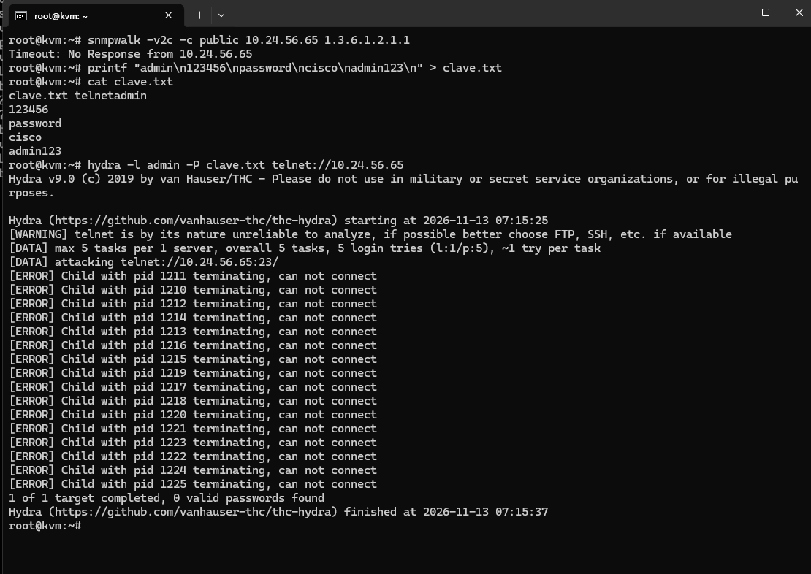

### Desde PC-Kali (VLAN 99, gestión autorizada)

| Prueba | Resultado | CIS |
|---|---|---|
| SSH a R | Muestra los banners, pide credenciales y entra con prompt `R>` | 1.1.6, 1.2.1, 1.3.x |
| `show ip ssh` | `SSH Enabled - version 2.0`, timeout 60 s, 3 reintentos | 2.1.1.1.4, 2.1.1.1.5, 2.1.1.2 |
| `enable` con contraseña incorrecta | `% Access denied` | 1.1.3, 1.4.1 |
| `snmpget -c ITLA-CIS-2356` | Responde | 1.5.5, 1.5.6 |
| `cisco.log` | Logs de R, SW y FW: `list GESTION-VTY denied ... 10.24.56.10` y `dstport=8080 action="deny"` | 2.2.4, FW 3.4, FW 7.3.1 |

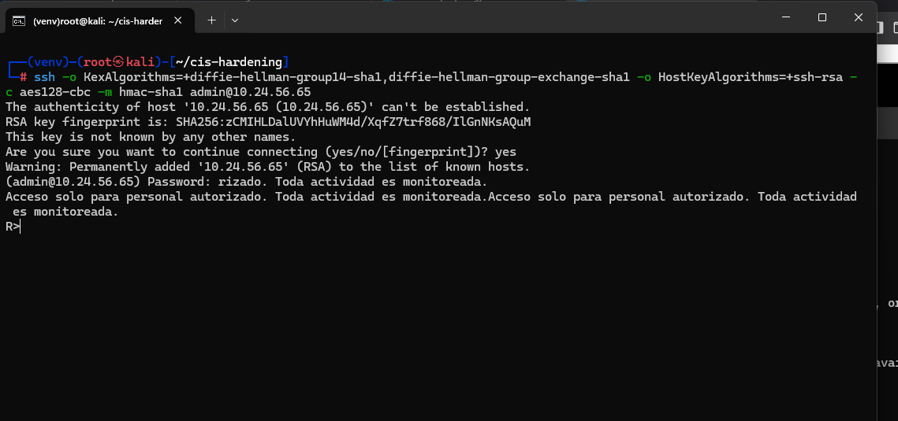
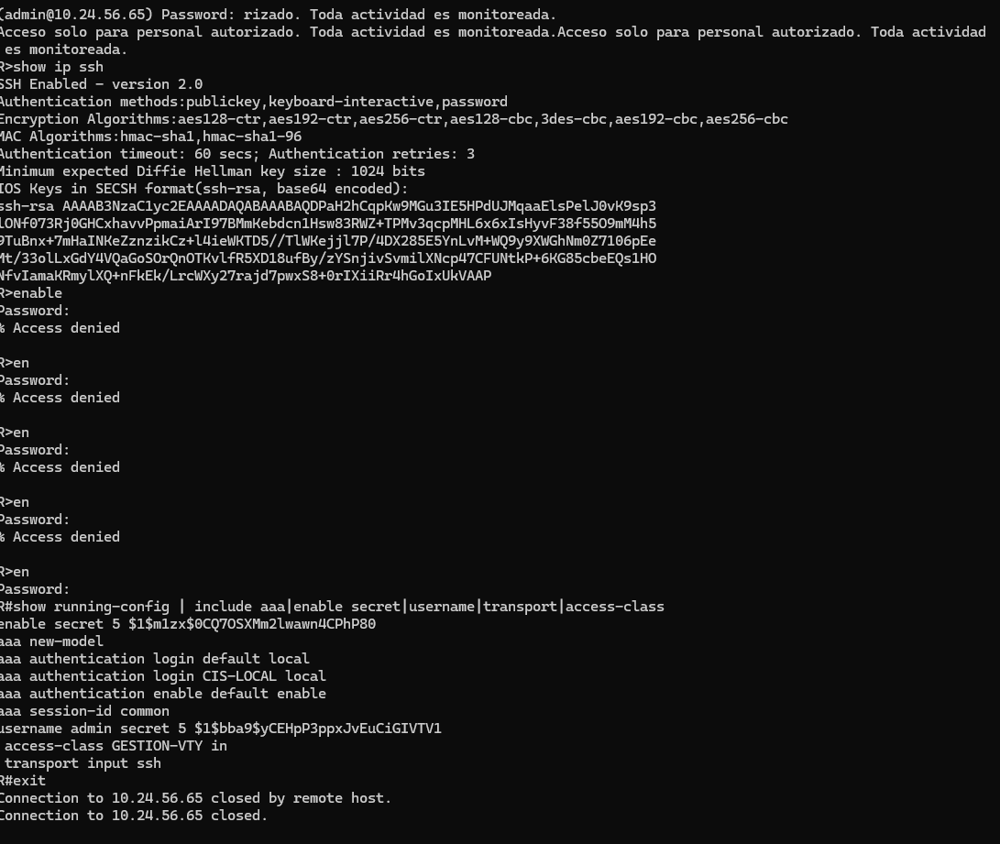
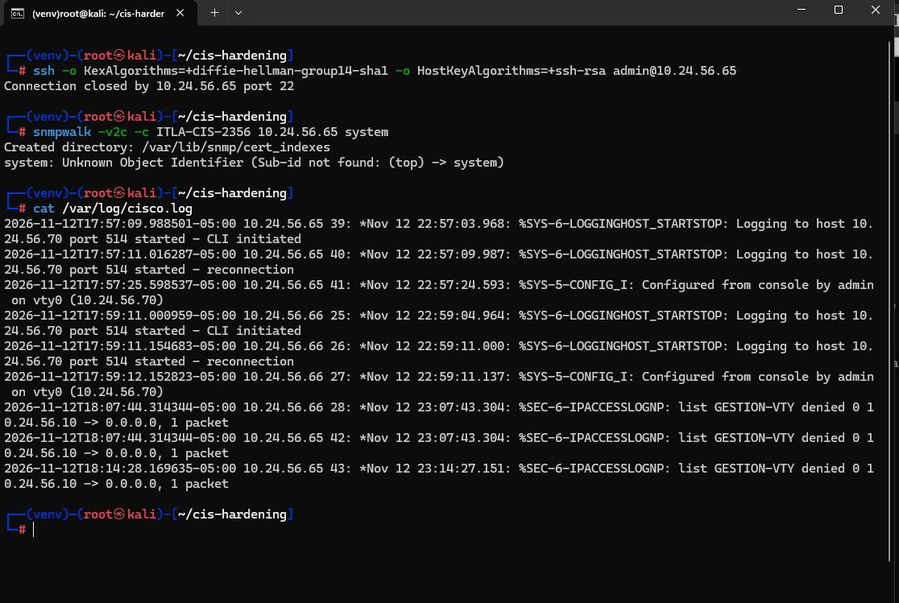

Ejemplo de log del FW bloqueando el puerto 8080 desde la red de usuarios:

```
devname="FW" ... srcip=10.24.56.10 ... dstip=35.180.86.68 dstport=8080 ... action="deny" policyid=0 ... service="tcp/8080"
```

---

## 9. Hallazgos sobre las herramientas

Ninguna de las dos herramientas es perfecta, por eso el script propio interpreta la configuración en vez de depender de ellas.

**ONYX (R y SW):**

| CIS | ONYX reporta | Realidad |
|---|---|---|
| 2.1.1.1.3 (antes) | Aprobado | La llave era de 1024 bits; ONYX solo verifica que exista una llave |
| 1.2.4 y 1.5.6 (antes) | Aprobado | Solo porque existía la ACL del NAT, que no estaba aplicada a VTY ni a SNMP |
| 2.1.4 (antes) | Aprobado | `service dhcp` está activo por defecto y no aparece en la configuración |
| 1.2.5 (después) | Fallido | `access-class GESTION-VTY in` sí está aplicado; ONYX no reconoce ACL con nombre |
| 2.2.7 (después) | Fallido | `logging source-interface` sí está configurado |
| 3.1.2 (después, R) | Fallido por **NVI0** | NVI0 es una interfaz interna de NAT que IOS no permite configurar |

**Fortigate_CIS_check (FW):** busca palabras clave con `grep`, por lo que:

- Da **falsos PASS**: banners (2.1.1/2.1.2) aprobados aunque estaban en `disable`, y 3.2 aprobado aunque la política usaba `service "ALL"` (busca el texto sin comillas).
- Da **falsos FAIL**: varias reglas buscan opciones que no existen en FortiOS 7.0 (`set v3-only`, `set admin-sessions-timeout`, `set password-policy` dentro de `system global`, `set chq`), así que nunca pueden aprobarse.

Por eso, en el FW, la mejora real se mide con el script (3 → 16 controles cumplidos), y la herramienta solo refleja el cambio en el control 1.3.

---

## 10. Problemas encontrados y soluciones

| Problema | Causa | Solución |
|---|---|---|
| El SW no respondía desde fuera de su red | La imagen IOL L2 trae `ip routing` activo e ignora `ip default-gateway` | `ip route 0.0.0.0 0.0.0.0 10.24.56.65` |
| Ping funcionaba, pero `apt`, `git clone` y HTTPS se colgaban | MTU de la red virtual (trunk 802.1Q en PNETLab y red NAT de VMware) y checksum offload de las NIC virtuales | `ip tcp adjust-mss` en R y `ethtool -K eth0 tx off ...` en los hosts resolvieron HTTP. Para instalar paquetes, los hosts se conectaron temporalmente al Cloud |
| HTTPS no completa el handshake TLS dentro del lab | Mismo problema de MTU (ya ocurría antes de agregar el firewall) | Se probó también `tcp-mss-sender/receiver` en la política del FW, sin éxito. La política sí permite HTTPS; el filtrado por servicio se demuestra con HTTP (permitido) frente al puerto 8080 (bloqueado) |
| `Incompatible ssh peer (no acceptable kex algorithm)` | Paramiko 5.x eliminó los algoritmos SHA1 que usa IOS 15.4 | `paramiko==3.5.1` |
| ONYX: `Unable to identify Cisco type` | El código compara con `"ios"` en minúsculas | Usar `-t ios` |
| OpenSSH de Kali cerraba la conexión con R | OpenSSH reciente no ofrece el kex ni el host key de IOS 15.4 | `-o KexAlgorithms=+diffie-hellman-group14-sha1 -o HostKeyAlgorithms=+ssh-rsa -c aes128-cbc -m hmac-sha1` |
| Al reiniciar R, las VLAN se quedaron sin gateway | Las IP de las subinterfaces no estaban guardadas en la startup-config | Se volvieron a configurar y se guardaron con `write memory` |
| Tras el hardening del FW, el script y SSH no podían entrar | La política de contraseñas (CIS 2.2.1) invalidó la contraseña existente y forzó su cambio en el siguiente login | Se cambió la contraseña en la consola por una que cumple la política |
| `ssh admin@fw "comando"` devolvía salida vacía | El post-login banner (CIS 2.1.2) exige presionar `a` | Exportar la configuración con Netmiko ([`fw_exportar_config.py`](scripts/fw_exportar_config.py)) |
| Administrar las VM desde Windows con el FW activo | El FW bloquea toda conexión entrante (comportamiento esperado) | Port-forward SSH solo desde 192.168.128.1 hacia Kali y PC-Usuarios, como acceso administrativo del laboratorio (políticas 2 y 3, con registro de tráfico). No expone la gestión de ningún equipo de red |

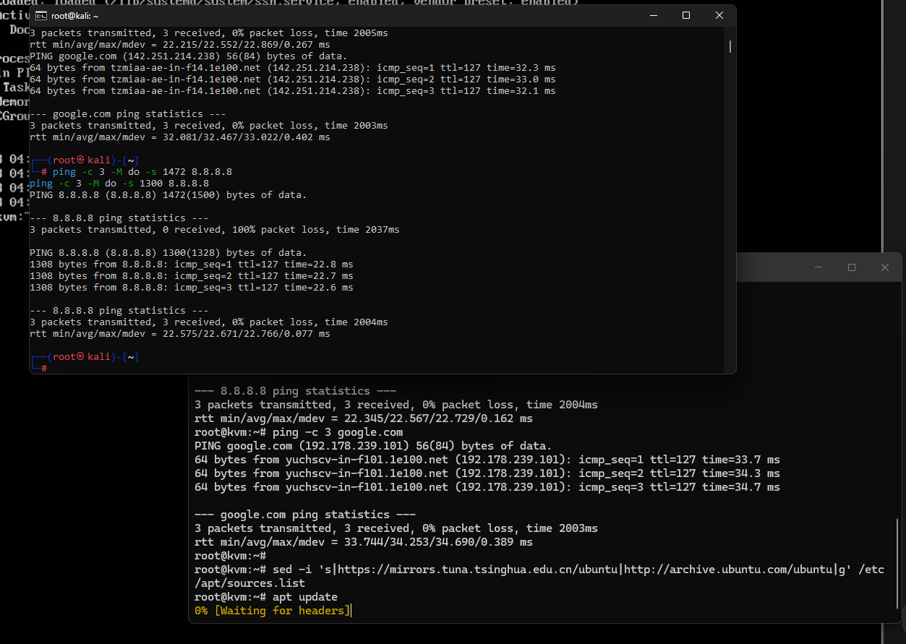

---

## 11. Estructura del repositorio

```
├── README.md
├── scripts/
│   ├── cis_hardening.py            # script de auditoría y hardening (R, SW, FW)
│   ├── fw_exportar_config.py       # exporta la configuración completa del FW
│   ├── kali_syslog_setup.sh        # Kali como servidor syslog
│   ├── pruebas_demostracion.sh     # comandos de las pruebas
│   ├── requirements.txt
│   └── terceros/                   # Fortigate_CIS_check (MIT)
├── running-configs/                # R, SW y FW antes y después del hardening
├── reportes/
│   ├── onyx/                       # ONYX: R y SW antes y después
│   ├── fortigate-cis-check/        # Fortigate_CIS_check: FW antes y después
│   └── script/                     # informes del script (auditoría, previo, posterior)
└── docs/
    ├── diagramas/                  # topología, control de acceso, flujo del script (.mmd y .png)
    └── img/                        # capturas de evidencia
```

> En los archivos publicados se reemplazaron los hashes de contraseñas (`secret 5`, `ENC`) y las llaves privadas de los certificados del FW por `<removido>`. Las configuraciones "antes" conservan las contraseñas en texto plano de la configuración insegura inicial, como evidencia del problema que se corrigió.
